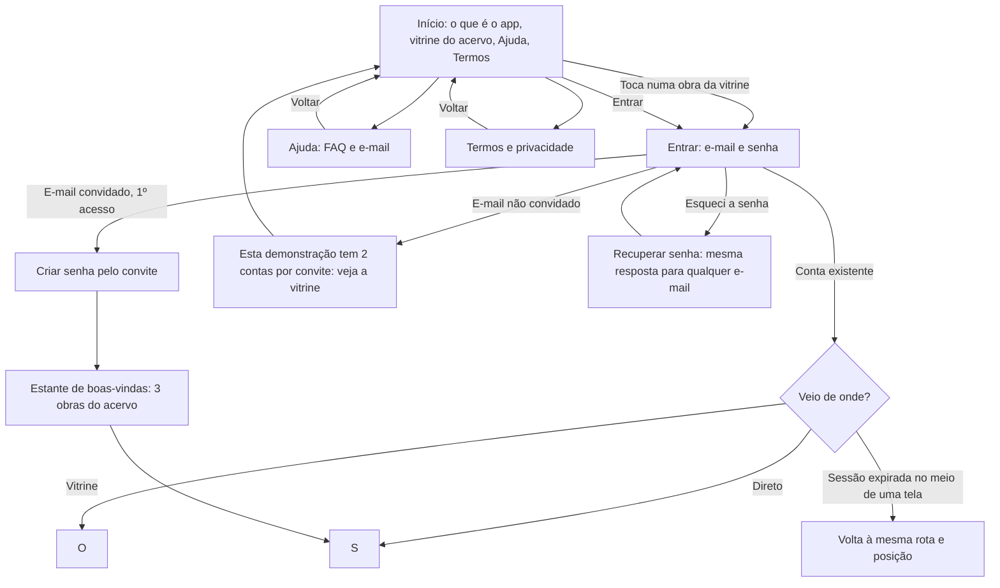
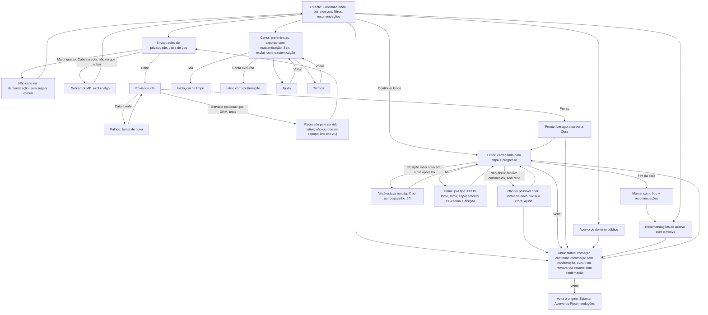
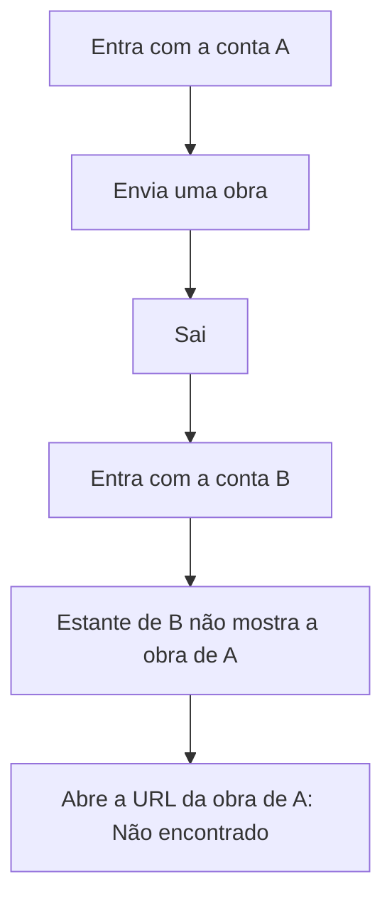

# Fidelidade — biblioteca

As três fases de desenho do produto (15 §12). Cada fase só começa com a anterior aprovada. A IA desenha, os
subagentes da skill `analise` conferem e o dono revisa antes de enviar ao cliente. **Cliente fictício:** o Pedro
aprova no papel de cliente.

**Meio da alta fidelidade:** **só código** (proposta, item 3; 15 §12.1, regra 5). A média fidelidade vai como
wireframe em HTML na prévia.

## 1. Baixa fidelidade — com a proposta — 2026-11-03 (versão 2, depois da conferência)

**O que vai:** as jornadas de cada perfil, o mapa de telas com a navegação, os estados de cada tela, o mapa de
acesso e as regras de servidor. A versão 1 foi conferida pelos subagentes `analista-ux-ui` e `analista-seguranca`,
que devolveram "ajustar antes". Esta versão 2 incorpora todos os achados de correção, e o corte da Open Library
da proposta versão 2 (orçamento de R$ 3.000). A tabela da conferência está no fim desta seção.

### Jornadas

**Visitante → leitor**

**Leitor**

**Cliente (dono do app)**

### Navegação
Os mesmos 4 destinos, **Estante · Acervo · Enviar · Conta**, ficam na barra inferior no celular e no topo no
desktop. A barra some no Leitor, que tem "voltar" próprio. Recomendações ficam na Estante e no fim da obra. Ajuda
e Termos ficam no Início e na Conta, e toda tela sem barra tem "voltar".

### Mapa de telas
| # | Tela | Rota | Perfis | Chega de | Vai para | Estados |
|---|---|---|---|---|---|---|
| 1 | Início | `/` | anônimo | link | Entrar, Ajuda, Termos; obra da vitrine → Entrar → Obra | vitrine carregando; vitrine indisponível (o resto da tela continua) |
| 2 | Entrar | `/entrar` | anônimo | Início, sessão expirada | rota de origem, Estante ou boas-vindas | senha errada; e-mail não convidado; recuperar senha enviado; criar senha pelo convite |
| 3 | Estante | `/estante` | leitor | Entrar, barra | Leitor, Obra, Enviar, Acervo, Recomendações, Conta | carregando; **erro ao carregar (nunca mostrado como vazio)**; vazia depois de excluir tudo; filtro sem resultado; sem leitura em andamento (o cartão some) |
| 4 | Obra | `/obra/[id]` | leitor (dono ou acervo) | Estante, Acervo, Recomendações | Leitor; volta à origem | carregando; erro; excluir e recomeçar com confirmação; obra do acervo: "remover da estante" |
| 5 | Enviar | `/enviar` | leitor | barra, Estante | Leitor (Ler agora), Obra, Ajuda | sem espaço; maior que a cota; enviando x%; falhou; recusado pelo servidor (não ocupou espaço) |
| 6 | Leitor de EPUB | `/ler/[id]` | leitor (dono ou acervo) | Estante, Obra, Enviar | Obra, Recomendações | carregando com capa; não abriu; posição de outro aparelho; URL renovada sem o leitor perceber |
| 7 | Leitor de mangá (CBZ) | `/ler/[id]` | leitor (dono ou acervo) | Estante, Obra, Enviar | Obra, Recomendações | idem ao 6; página que não baixa: tentar de novo nela; **direita para a esquerda por padrão, troca por obra** (toque, deslizar e barra de progresso seguem a direção) |
| 8 | Acervo | `/acervo` | leitor | barra | Obra | carregando; erro |
| 9 | Recomendações | `/recomendacoes` | leitor | Estante, fim da obra | Obra | carregando; conta sem histórico: "para começar", com obras do acervo; acervo todo lido: "você leu todo o acervo" |
| 10 | Conta | `/conta` | leitor | barra | Exportar, Sair, Excluir, Ajuda, Termos | reautenticação; exportação pronta; exclusão pendente (nova tentativa automática) |
| 11 | Ajuda e FAQ | `/ajuda` | todos | Início, Conta, Enviar, Leitor | voltar à origem; e-mail | — |
| 12 | Termos e privacidade | `/termos` | todos | Início, Conta, Enviar | voltar à origem | — |
| 13 | Não encontrado | qualquer rota inválida ou obra de outra conta | todos | — | Estante (leitor) ou Início (anônimo) | — |

**Regras de tela:** a obra do acervo entra na estante e no "Continuar lendo" quando o leitor a começa. O leitor
abre na posição mais recente de qualquer aparelho e avisa quando a do aparelho atual for outra.

### Mapa de acesso (papel × tela × ação)
| Tela | Anônimo | Leitor |
|---|---|---|
| Início, Ajuda, Termos, Não encontrado | ver | ver |
| Entrar | entrar; criar senha **só com e-mail convidado**; recuperar senha | — |
| Estante, Enviar, Recomendações, Conta | — (vai para Entrar e volta) | só as **próprias** obras, posições, preferências e dados |
| Obra e Leitor | — (vai para Entrar se veio da vitrine; senão, Não encontrado) | as **próprias** obras e as do acervo; obra de outra conta: Não encontrado (404, nunca 403) |
| Acervo | vitrine no Início (capa, título, autor) | ver e ler |
| Arquivos no Storage | — | só os próprios e os do acervo, por URL assinada de 60 a 300 s |

### Regras de servidor (valem mesmo que a tela seja burlada)
1. **RLS em toda tabela do schema `public`**, com policy de dono em SELECT, INSERT, UPDATE e DELETE (`USING` e `WITH CHECK` com `auth.uid() = dono_id`). `storage.objects` com policy pelo prefixo `{auth.uid()}/`. Uma migration com `ASSERT` falha se alguma tabela de `public` estiver sem RLS.
2. **Acervo separado:** tabela própria e só de leitura, sem GRANT de escrita a `authenticated` nem a `anon`. **Nenhuma policy usa `dono_id IS NULL`.** A vitrine do anônimo é uma view `security_invoker` só com capa, título e autor do acervo. As tabelas filhas (estante, posições) exigem no `WITH CHECK` que a obra seja do dono ou do acervo. A recomendação roda como o leitor, nunca com `service_role`.
3. **Cadastro público desligado no Auth.** Só os 2 e-mails convidados entram, por convite com o papel de serviço ou por Auth Hook com allowlist, guardada numa variável da Vercel e nunca no repositório. A vaga liberada por uma exclusão só volta para um e-mail da lista.
4. **Envio:** o caminho `{uid}/{uuid}` é gerado pelo servidor, e o nome enviado serve só para exibição. O bucket tem `file_size_limit` e `allowed_mime_types` (EPUB e ZIP). A cota de 50 MB é a **soma da conta**, conferida antes de gerar a URL e recalculada depois do envio. O objeto fica "pendente", fora da estante e do leitor, até a validação, e é apagado se reprovar.
5. **Validação de EPUB e CBZ (os dois são ZIP), no servidor e por streaming**, antes de a obra virar "pronta". O tipo é conferido pelo conteúdo. Há tetos de entradas, de tamanho descompactado (contando os bytes lidos, não o tamanho declarado), de razão de compressão e de páginas, com números fixados no Dia 1 junto com a medição do R8. Nenhuma entrada com `../` ou caminho absoluto. O acervo passa pela mesma validação no script de carga.
6. **EPUB renderizado sem script:** `epub.js` com scripts desligados e iframe sem `allow-scripts`. A CSP do leitor tem `script-src 'self'` e `default-src 'self' blob:` mais o host do Storage, e nenhum host externo para img, style, font e connect. CBZ: só imagens JPEG, PNG, WebP ou GIF, identificadas pelos bytes; SVG fica fora, e tudo é exibido por ``.
7. **Service worker:** guarda só o esqueleto estático do app. Nada autenticado, nada do Storage, nenhuma URL assinada. Sair e excluir a conta limpam os caches.
8. **Exclusão de conta**, em ordem: reautenticar; remover todos os objetos do prefixo `{uid}/` pela API do Storage, no servidor; apagar o usuário no Auth, com `ON DELETE CASCADE` em todas as tabelas. Se algo falhar, fica uma pendência idempotente com nova tentativa. No fim, conferir 0 linhas e 0 objetos.
9. **Conta:** exportar pede reautenticação recente e tem limite de frequência. A recuperação de senha dá a mesma resposta para qualquer e-mail. O retorno depois de entrar só aceita caminho relativo do próprio site (começa com `/`; `//` e `/\` são recusados).
10. **Limite de requisição** por IP e por conta no login, na recuperação de senha e na geração da URL de envio. Senha com tamanho mínimo, conferido também no app. Proteção contra senha vazada ligada se o plano permitir; se não permitir, fica registrada como risco aceito.

### Conferência (3-Nov-2026, versão 1 → versão 2)
| Área | Veredito na v1 | Achados | Como entraram na v2 |
|---|---|---|---|
| **UX/UI** (`analista-ux-ui`) | ajustar antes | 1 alto, 9 médios, 5 baixos, 2 melhorias, 4 positivos | Estado de erro e carregando no Leitor (A-01); estados do envio (A-02); dois ramos de tamanho (A-03); coluna Estados (A-04); recomendações sem histórico (A-05; o caso da Open Library saiu com o corte); entrada por convite, recuperar senha e sessão expirada (A-06); Sair, pós-exclusão e jornada do Cliente (A-07); vitrine → Entrar → Obra (A-08); posição mais recente com aviso (A-09); direção do mangá e painel por tipo (A-10); Ajuda e Termos com volta (A-11); ficha da Open Library saiu com o corte (A-12); Obra volta à origem (A-13); navegação no desktop (A-14); tela Não encontrado e confirmações (A-15); "Ler agora" depois do envio (A-16, melhoria aceita); condições da média fidelidade no §2 (A-17) |
| **Segurança** (`analista-seguranca`) | ajustar antes | 4 altos, 6 médios, 1 baixo, 3 positivos | Cadastro só por convite (A-01 → regra 3); EPUB sem script e CSP (A-02 → regra 6); RLS em toda tabela com ASSERT (A-03 → regra 1); acervo separado, sem `IS NULL` (A-04 → regra 2); EPUB também é ZIP, com tetos e validação no servidor (A-05 → regra 5); limites do bucket, cota pela soma, objeto pendente (A-06 → regra 4); exclusão em ordem com nova tentativa (A-07 → regra 8); Open Library saiu com o corte, e a regra deixou de existir (A-08); service worker (A-09 → regra 7); exportar com reautenticação e retorno relativo (A-10 → regra 9); limite de requisição e senha (A-11 → regra 10) |

- [x] **UX/UI:** toda jornada chega ao fim sem beco sem saída; os mesmos 4 destinos no celular e no desktop. Achados da v1 incorporados; a v2 não foi conferida de novo.
- [x] **Segurança:** nenhuma tela ou ação aberta a quem não deve; o que é do leitor só aparece para ele. Achados da v1 incorporados; a v2 não foi conferida de novo.
- [x] Dono (PM) revisou.

**Aprovado pelo cliente:** no aceite da proposta (`PROPOSTA.md` §9), em 2026-11-04.

## 2. Média fidelidade — Dia 0
Condições de conferência, fixadas desde já: os três estados (carregando, vazio, erro) em toda tela que lê dados;
360 px (D3); fonte a 140%; temas claro, escuro e sépia; alvo de toque de 44 px ou mais; o leitor de CBZ da direita
para a esquerda; contagem de toques do critério (a), que é enviar e começar a ler em até 3 toques.
<Wireframes preenchidos no Dia 0.>

## 3. Alta fidelidade — Dia 1
<Preenchida no Dia 1: Estante e Leitor.>
